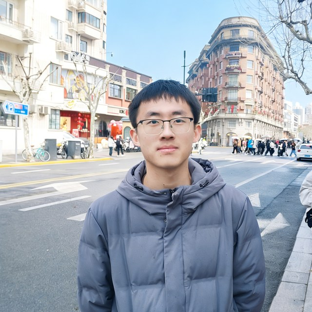

# Academic Page Story of Dongxu Liu

## About Me

I am a third-year undergraduate in [the College of Artificial Intelligence at Jilin University](https://sai.jlu.edu.cn/), majoring in Artificial Intelligence.

My work spans optimization theory, spiking neural networks, and model compression, and more recently embodied intelligence and LLM agents. My aim is to work on problems that matter in practice rather than on metrics alone.

## Research Interests

Optimization; Spiking Neural Networks; Model Compression; LLM Agents; Embodied AI.

## Links

[Email](mailto:liudx9924@mails.jlu.edu.cn)
[Google Scholar](https://scholar.google.com/citations?hl=en&user=053eRGQAAAAJ)
[GitHub](https://github.com/ldx825)
[CV](assets/files/ldx_26_3_1_Academic_CV_Template.pdf)

## News

+ NeurIPS 2026: Our paper "Rethinking Gradient Approximation in Quantization: A Zeroth-Order Expectation Perspective" was accepted.
+ AISTATS 2026: Our paper "Zeroth-Order Stochastic Compositional Gradient Descent: Towards Black-Box Sparse AUC Maximization" was accepted.
+ AAAI 2026: Our paper "Towards Nonlinear Sparse AUC Maximization via Compositional Stochastic Hard Thresholding" was accepted.
+ Jan 2025: Started my research journey at the College of Artificial Intelligence, Jilin University.
+ Aug 2024: Began undergraduate studies in Artificial Intelligence at Jilin University.

## Experience

Short codes in square brackets are reused as tags on publication rows.

### Jilin University, College of Artificial Intelligence [JLU-AI]

Research Intern — with Bin Gu, Wanli Shi, Zhaogeng Liu and Tianxing Man.
Optimization theory, spiking neural networks, model compression and acceleration.
Jan 2025 - Mar 2026.

### Shanghai Jiao Tong University, AutoLab / Awaken Robotics [SJTU-AI]

Research Intern — with Zhipeng Zhang.
VLA, World Action Models (WAM), and embodied intelligence.
Mar 2026 - Present.

### Jilin University, College of Artificial Intelligence [JLU-Agent]

Research Intern — with Yuan Wu.
LLM agents and recursive self-improvement (RSI).
Jul 2026 - Oct 2026.

### Independent Research [SOLO]

Self-directed work on black-box optimization and visual model compression and acceleration.

## Education

Jilin University, College of Artificial Intelligence, B.Eng. in Artificial Intelligence. Aug 2024 - Present.

## Publications

Tags link to the corresponding entry in Experience.

+ Towards Nonlinear Sparse AUC Maximization via Compositional Stochastic Hard Thresholding, Wenkang Wang, Dongxu Liu, Bin Gu*, AAAI 2026. Second author. Published. [JLU-AI] Paper: https://ojs.aaai.org/index.php/AAAI/article/view/39856
+ Zeroth-Order Stochastic Compositional Gradient Descent: Towards Black-Box Sparse AUC Maximization, Wenkang Wang, Dongxu Liu, Bin Gu*, AISTATS 2026. Second author. Published. [JLU-AI] Paper: https://proceedings.mlr.press/v300/wang26g.html
+ SpikingCLIP: Direct ANN-to-SNN Conversion of CLIP via Channel-to-Token Outlier Migration Technique, Tianshuo Chen, Hanyuan Zheng, Haozhen Zhang, Dongxu Liu, Wanli Shi, Zhaogeng Liu, Bin Gu*, CVPR 2026. Fourth author. Pending. [JLU-AI] Paper: https://openreview.net/forum?id=L1QL5uNDAn Code: https://github.com/JLU-Solar/CVPR-CLIP
+ Hybrid Zeroth- and First-Order Method for Stochastic Nonsmooth Minimax Optimization, ICLR 2027. Third author. Under review. [JLU-AI] Paper: https://openreview.net/forum?id=5S23ZjJMXd Code: https://github.com/ldx825/ZOFOGDA_Nips26
+ Rethinking Gradient Approximation in Quantization: A Zeroth-Order Expectation Perspective, Wenkang Wang, Jia Zhang, Zelin Wei, Dongxu Liu, Wanli Shi, Bin Gu*, NeurIPS 2026. Co-first author. Published. [JLU-AI] Paper: https://openreview.net/forum?id=0ZZ3tyBGyc Code: https://github.com/wangwk699/ZOE_Grad
+ FG-DMARS: Fine-Grained Multi-Agent Review for Cost-Efficient and Stable LLM Reasoning. Corresponding author; supervised the final-year project of a senior student in the college. [JLU-AI]
+ Spiking LLM Deployment on Neuromorphic Hardware (Lynxi KA200). Core contributor. Project, not a paper. Spiking large language models, mapping operators onto the chip, on-device inference, and hardware/software co-debugging. [JLU-AI] Project: https://app.notion.com/p/22464f205f65808d9657c220cf599551 Code: https://github.com/JLU-Solar/snn-chat-demo
+ WAM-Adapter: Efficiently Adapting Video-DiT World Representations to Robot Actions, ICLR 2027. First author. Under review. [SJTU-AI] Code: https://github.com/ldx825/WAM-Adapter Project: https://ldx825.github.io/WAM-Adapter-Homepage/
+ AutoPrune-Plus: Is the Most Attended View Deserve the Most Tokens?, TPAMI. Co-first author. Under review. [SJTU-AI] Paper: https://cn.overleaf.com/read/dymsxfncryzt Code: https://github.com/ldx825/vla_vlm-pruning-method
+ TaskMatch: Learning Task-Aware Relevance Beyond Semantic Similarity for Agent Harnesses, ICLR 2027. First author. Under review. [JLU-Agent] Paper: https://www.preprints.org/manuscript/202610.0778 Code: https://github.com/ldx825/learned-relevance-scorer-agent-retrieval
+ RC-ZOQO: Certifying Resolution Limits in Quantized Zeroth-Order Optimization, ICASSP 2027. First author. Under review. [SOLO] Paper: https://github.com/ldx825/RC-ZOQO_ICASSP-2027/blob/main/RC_ZOQO_ICASSP2027_V06/main.pdf Code: https://github.com/ldx825/RC-ZOQO_ICASSP-2027
+ AdaScale: Diagnosing and Adapting Multi-Scale Fusion for Training-Free Zero-Shot Recognition, ICASSP 2027. First author. Under review. [SOLO] Paper: https://github.com/ldx825/AdaScale_ICASSP-2027/blob/main/paper/main.pdf Code: https://github.com/ldx825/AdaScale_ICASSP-2027
+ Context-Dependent Precision Utility for Mixed-Precision Object Detection, ICASSP 2027. First author. Under review. [SOLO] Paper: https://github.com/ldx825/Mixed-Precision-Object-Detection_ICASSP-2027/blob/main/paper/main.pdf Code: https://github.com/ldx825/Mixed-Precision-Object-Detection_ICASSP-2027
+ Certified Zeroth-Order Exact Penalization for Black-Box Sparsity-Constrained Optimization, ICASSP 2027. First author. Under review. [SOLO] Paper: https://github.com/ldx825/ZO-IDEP_ICASSP-2027/blob/main/ZO_IDEP_ICASSP2027/main.pdf Code: https://github.com/ldx825/ZO-IDEP_ICASSP-2027

## Selected Awards

+ 2025 - Jilin University First-Class Scholarship
+ 2025 - Jilin University Outstanding Student
+ 2025 - National College Students Mathematics Competition, Provincial Second Prize

Rendered as a collapsed disclosure ("3 awards").

## Services

+ Reviewer, International Conference on Learning Representations (ICLR 2027)
+ Reviewer, IEEE International Conference on Acoustics, Speech and Signal Processing (ICASSP 2027)

Displayed as a collapsed disclosure ("2 reviewer roles").

Rendered as a collapsed disclosure ("2 reviewer roles").
